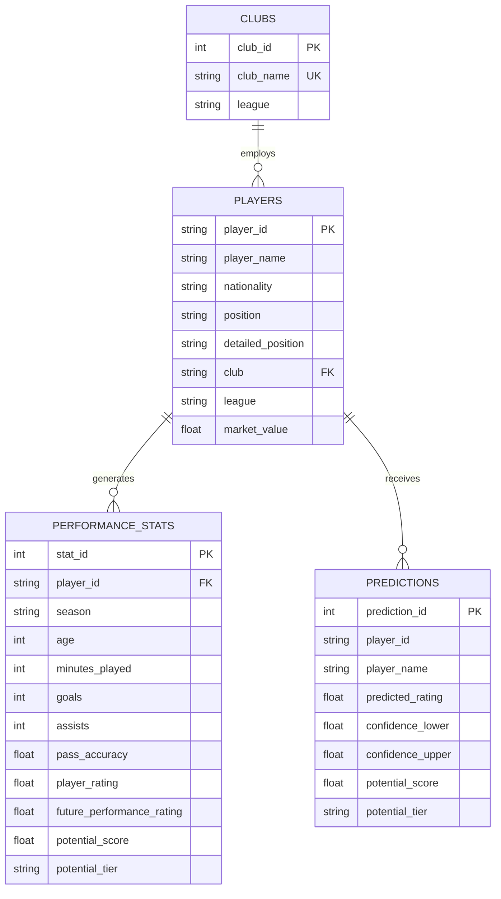

# ⚽ FOOTBALL IQ: Player Performance Prediction & Scouting Intelligence Platform

[](https://www.python.org/)
[](https://scikit-learn.org/)
[](https://streamlit.io/)
[](https://www.sqlite.org/)
[](https://pytest.org/)

An end-to-end, production-grade football analytics and scouting platform designed for sporting directors, recruitment analysts, and tactical scouts. **FOOTBALL IQ** unifies modern machine learning regression, unsupervised archetype clustering, Explainable AI (XAI), relational SQL storage, and a sleek interactive Streamlit web dashboard.

---

## 🌟 Key Features

1. **🔮 Future Performance Prediction**:
   - Predicts a player's future performance rating for subsequent seasons using chronological ML models (Gradient Boosting, Random Forest, XGBoost, Linear Regression) with **95% RMSE confidence intervals**.
2. **⭐ AI Potential Score & Prospect Classification**:
   - Calculates age-adjusted player potential (0–100) and classifies prospects into distinct tiers: *Elite Prospect*, *High Potential*, *Promising*, *Development Player*, and *Low Priority*.
3. **🎯 Multi-Criteria Scouting Recommendation Engine**:
   - Evaluates recruitment targets using a dynamic **Scouting Match Score (0–100)** incorporating positional fit, age trajectory, statistical outputs, potential upside, and transfer budget efficiency.
4. **💎 Hidden Gem Detection**:
   - Automatically detects undervalued young talents (Age ≤ 23, Market Value ≤ €35M, Potential ≥ 78) who outperform their valuation bracket.
5. **🔄 Tactical Role & Alternate Position Recommender**:
   - Evaluates player tactical attributes against other position requirements to suggest alternative tactical deployments (e.g. CM to CAM, RB to RWB, CB to CDM).
6. **📊 Percentile-based Strengths & Weaknesses**:
   - Benchmarks player statistics strictly against same-position peers (e.g., comparing strikers with strikers, fullbacks with fullbacks).
7. **🧬 Tactical Archetype Clustering (K-Means & PCA)**:
   - Unsupervised clustering discovering 5 core playing styles: *Goal Scorers*, *Creative Playmakers*, *Ball-Winning Engines*, *Rock-Solid Defenders*, and *Balanced All-Rounders*, visualized via 2D/3D PCA.
8. **⚔️ Head-to-Head Multi-Player Comparison**:
   - Side-by-side player comparisons with interactive multi-axis tactical radar charts and statistical diff tables.
9. **🗄️ Relational SQLite Scouting Database**:
   - Fully normalized relational schema with structured SQL queries for club recruitment workflows and an interactive SQL execution console.
10. **🔍 Explainable AI (XAI)**:
    - Transparent feature contribution attribution explaining the exact performance drivers behind every prediction.

---

## 🏗️ System Architecture

```text
Football Player Performance Prediction & Scouting System/
│
├── app.py                         # Multi-tab Streamlit Analytics Dashboard
├── requirements.txt               # Dependency specifications
├── README.md                      # Comprehensive documentation
├── .gitignore                     # Git ignore rules
│
├── data/
│   ├── raw/
│   │   └── players.csv            # Multi-season raw player dataset (2,400+ records)
│   └── processed/
│       └── players_processed.csv  # 75-feature cleaned & engineered dataset
│
├── database/
│   └── football_scouting.db       # SQLite relational database
│
├── models/
│   ├── performance_model.pkl      # Best serialized ML regressor (Gradient Boosting)
│   ├── scaler.pkl                 # Feature StandardScaler
│   ├── clustering_model.pkl       # Fitted K-Means model (k=5)
│   ├── cluster_scaler.pkl         # Clustering feature scaler
│   ├── pca_model.pkl              # 2D PCA projection model
│   └── model_metadata.json        # Evaluation metrics, feature importance, and config
│
├── notebooks/
│   ├── 01_data_cleaning.ipynb     # Data validation & missing value handling
│   ├── 02_eda.ipynb               # Positional EDA & correlation analysis
│   ├── 03_feature_engineering.ipynb # Domain scoring & per-90 metrics
│   ├── 04_model_training.ipynb    # ML benchmarking & feature importance
│   └── 05_player_clustering.ipynb # K-Means & PCA archetype discovery
│
├── src/
│   ├── __init__.py
│   ├── generate_data.py           # Realistic multi-season dataset generator
│   ├── data_processing.py         # Data cleaning & quality report pipeline
│   ├── feature_engineering.py     # Domain metrics & potential formulas
│   ├── model_training.py          # ML training, cross-validation & clustering
│   ├── prediction.py              # Inference engine, uncertainty bounds & XAI
│   ├── scouting.py                # Match score algorithm, hidden gems & benchmarking
│   └── database.py                # SQLite ORM & query runner
│
├── tests/
│   ├── __init__.py
│   └── test_system.py             # Pytest automated test suite
│
└── scripts/
    └── generate_notebooks.py      # Notebook generator utility
```

---

## 🔬 Machine Learning & Evaluation

### Chronological Train / Test Split
To prevent **target leakage** and simulate real-world scouting conditions, a chronological split was utilized:
- **Training Set (80%)**: Seasons 2021/22, 2022/23, 2023/24 (1,821 records)
- **Testing Set (20%)**: Season 2024/25 (607 records)

### Benchmark Results

| Model Algorithm | MAE | MSE | RMSE | R² Score |
| :--- | :---: | :---: | :---: | :---: |
| **Gradient Boosting Regressor** | **0.865** | **1.214** | **1.102** | **0.9880** |
| **Linear Regression** | 0.898 | 1.311 | 1.145 | 0.9871 |
| **Random Forest Regressor** | 0.912 | 1.398 | 1.182 | 0.9862 |
| **XGBoost Regressor** | 0.934 | 1.456 | 1.207 | 0.9856 |

*The best model (**Gradient Boosting**) was selected and serialized for production inference.*

### Top Predictive Features
1. `player_rating` (Current Season Baseline)
2. `passing_score` (Midfield & Distribution Quality)
3. `age` (Career Curve / Development Window)
4. `attacking_score` (Offensive Contribution)
5. `progressive_passes_per_90` (Vertical Playmaking)
6. `goals_per_90` (Finishing Output)
7. `minutes_played` (Match Experience)

---

## 🗄️ Relational Database Schema



---

## 🚀 Quickstart & Installation

### 1. Clone the Repository
```bash
git clone <repository-url>
cd "Football Player Performance Prediction & Scouting System"
```

### 2. Install Dependencies
```bash
pip install -r requirements.txt
```

### 3. Pipeline Execution (Optional - Precomputed assets are included)
```bash
# 1. Generate multi-season dataset
python src/generate_data.py

# 2. Clean and engineer features
python src/data_processing.py

# 3. Train ML models & cluster archetypes
python src/model_training.py

# 4. Populate SQLite database
python src/database.py
```

### 4. Run Automated Tests
```bash
python -m pytest -v tests/test_system.py
```

### 5. Launch the Streamlit Dashboard
```bash
streamlit run app.py
```

---

## 🔮 Future Roadmap

- 📡 **Real-time Live Football APIs**: Integration with StatsPerform / Wyscout / FBref live match feeds.
- 🏥 **Injury Probability Prediction**: Deep learning models estimating muscle fatigue and injury likelihood.
- 💶 **Dynamic Transfer Valuation Engine**: Predictive models estimating market value escalation in future transfer windows.
- 📹 **Computer Vision Match Tracking**: Pitch control and spatial player tracking from broadcast video.
